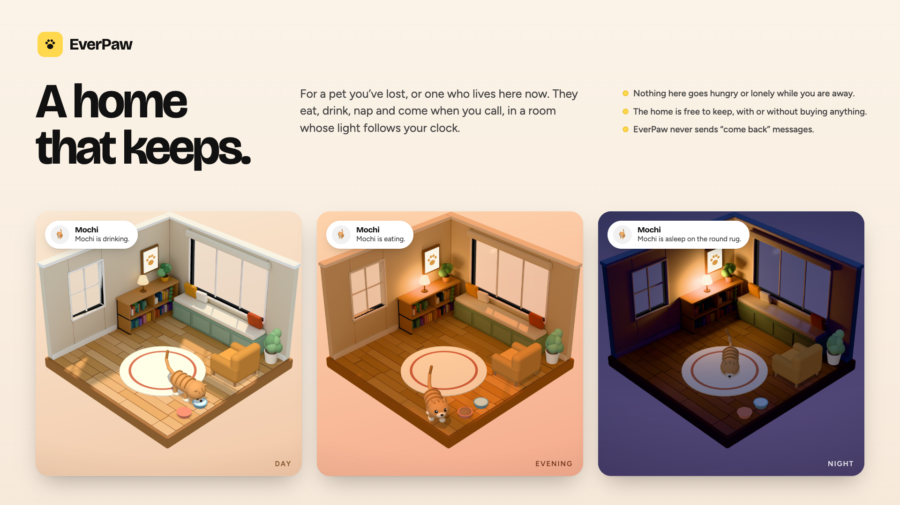
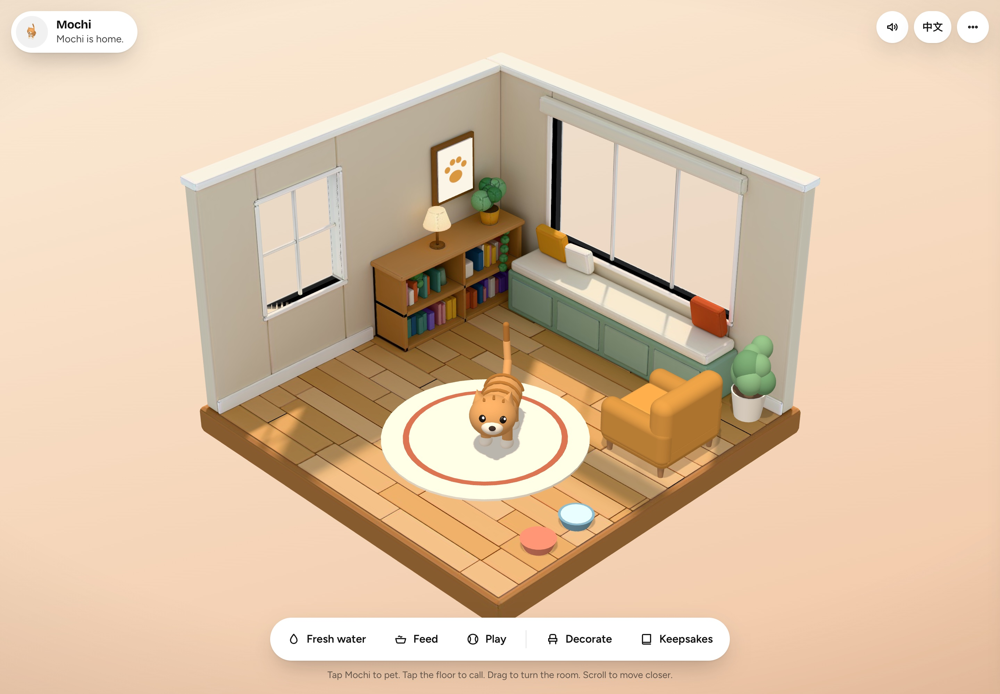
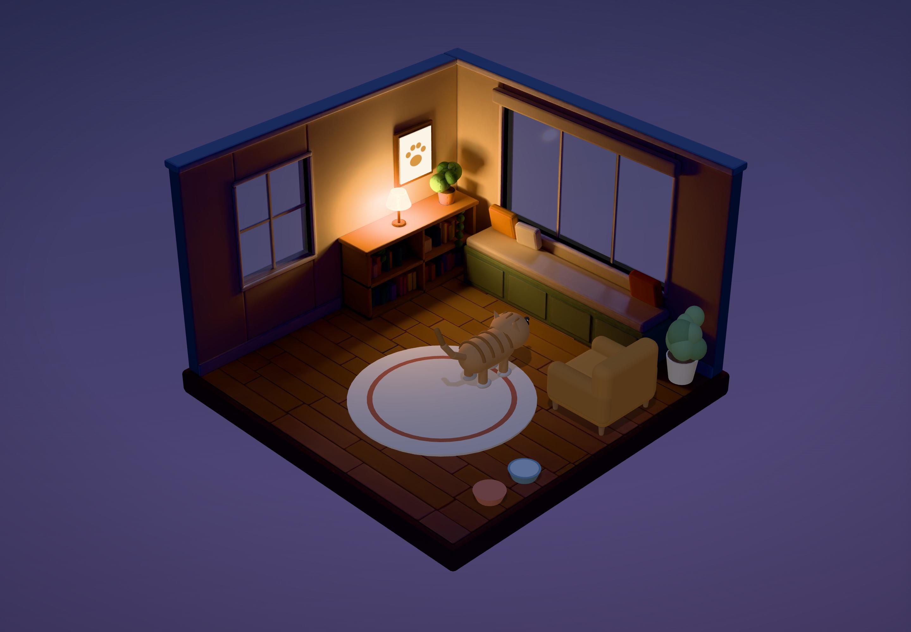
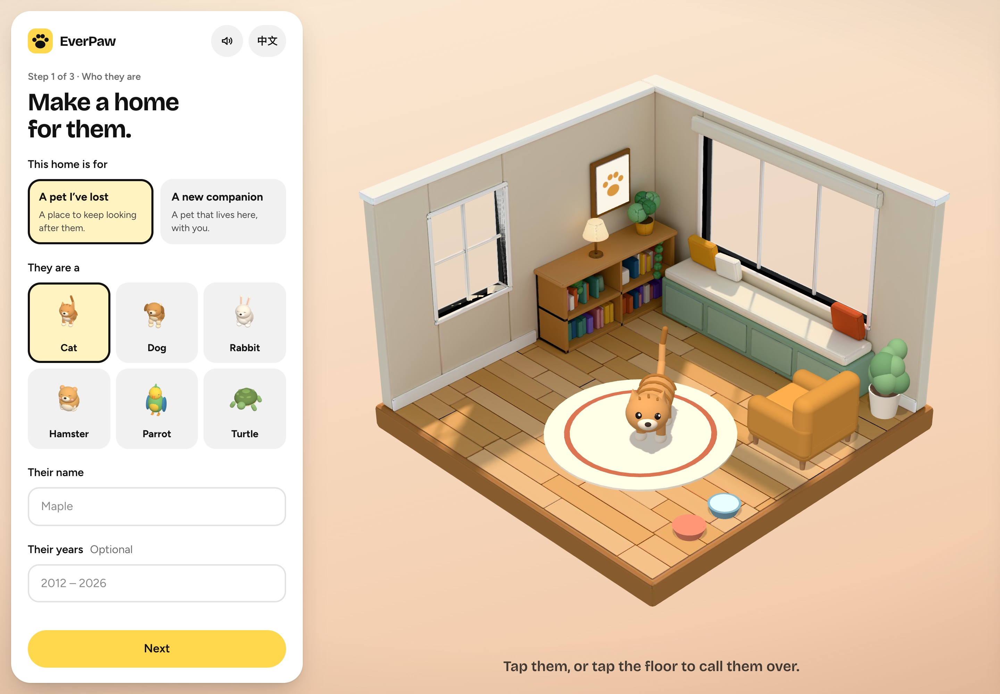
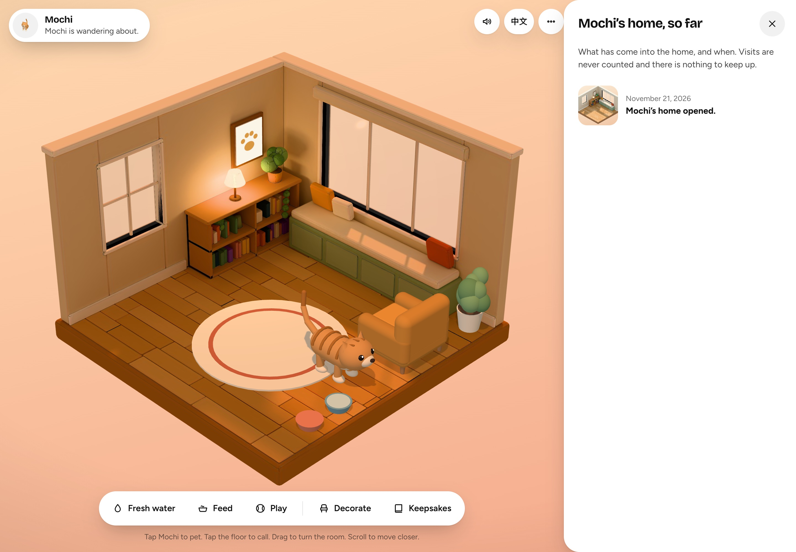

# EverPaw Home

English · [简体中文](README.zh-CN.md)

**A small 3D home for a pet you've lost, or one who lives with you now. Keep the water fresh and the bowl full, and they'll wander, nap and come when you call.**

[Open EverPaw →](https://cynthiawongss.com/everpaw/)



*Three views of one home, captured from the live app with the buttons hidden. Mochi is a fictional cat; each caption is the status line the app showed at that moment.*

When a pet dies, the house can feel empty all at once. EverPaw gives them a place again: a quiet room where they still eat, drink, play and sleep, and where you can keep a few words about them. It works the same way for a companion you have never had.

## A home that asks nothing of you

Remembering should never feel like a chore. These promises are written into the app itself.

| EverPaw promises | What that means |
| --- | --- |
| Nothing here goes hungry or lonely while you are away. | There are no hunger bars and nothing gets sad. Come back after a day or a year and they are simply home. |
| Visits are never counted and there is nothing to keep up. | No streaks, no goals, no daily tasks. |
| EverPaw never sends "come back" messages. | Reminders are off, and there is no setting that turns nagging on. |
| The home is free to keep, with or without buying anything. | Furniture is optional. Nothing is locked behind a purchase. |
| You can download everything or delete it whenever you like. | One file holds the whole home. Deleting it removes it from this device. |

## What you can do

| Part | What it gives you |
| --- | --- |
| Make a home | Three steps. **Who they are**: a pet you've lost or a new companion; a cat, dog, rabbit, hamster, parrot or turtle; their name and years. **How they look**: three coat colours, five markings and three sizes. You can add one photo: EverPaw reads their colours from it and hangs it on the wall. **Where they live**: one of three rooms. |
| Spend time | **Fresh water**, **Feed** and **Play**. Tap them to pet them, tap the floor to call them over, drag to turn the room, scroll to move closer. A line at the top tells you what they are doing, such as "Mochi is asleep on the round rug." |
| Decorate | Add any of 14 things, from a cardboard box to a cat tree, and place them on the floor grid. Some change what they do: a bed becomes where they sleep, a ball is something to chase. |
| Keepsakes | The words you wrote about them, and a short record of what came into the home and when. |

## The light follows your clock

The room changes with the time on your device: daylight until 5 pm, a warm evening until 8 pm, then night, when the lamp and candles come on. Leave it alone for a few seconds and the buttons fade away, so the room is all you see.

| Day | Night, with the buttons faded |
| --- | --- |
|  |  |

## An example: Mochi

This fictional home was made in the live app: **A pet I’ve lost** → **Cat** → *Mochi*, *2011 – 2026* → **Stripes** → the **Window seat** room → **Open Mochi’s home**.



Under **Keepsakes**, the home keeps the date it was opened and anything added later. Visits are not recorded.



## Made for EverPaw

The three rooms (a window seat, an attic and a glasshouse) were modelled for this project in Blender, each with light baked separately for day, evening and night. The pets are built and animated in three.js. The interface is in English and Chinese.

## What is not real yet

| Current behaviour | What it means for you |
| --- | --- |
| Saved in this browser only | No account or cloud sync. Use **Download everything** before clearing site data or changing devices. |
| A photo sets colours, not a model | The pet is a stylised 3D animal in your pet's colours, not a model generated from the photo. The photo stays on your device. |
| Test checkout | Prices from $0.99 to $5.99 are shown, but no payment provider is connected and nothing is charged. |
| Page views on the published site | The home itself keeps no record of your visits, but the published site loads Umami, which counts page views. |

## Run it locally

```bash
python3 -m http.server 8000
```

Then open http://localhost:8000/. No build step is needed.

| File | What it does |
| --- | --- |
| `index.html`, `app.js`, `ui.css` | The interface and saved state |
| `data.js` | Names, prices and every line of text, in English and Chinese |
| `world.js` | The 3D room, the pets and their behaviour, decorating on a grid |
| `sound.js` | Synthesised sound |
| `rooms/` | The three rooms: a model plus baked light for day, evening and night |
| `tools/build_rooms.py` | The Blender script that models the rooms and bakes their light |
| `three/` | three.js r160 (MIT, see `three/LICENSE`) |

To rebuild the rooms (needs Blender 4.5 LTS):

```bash
/Applications/Blender.app/Contents/MacOS/Blender --background --python tools/build_rooms.py -- rooms bay attic glass
```
