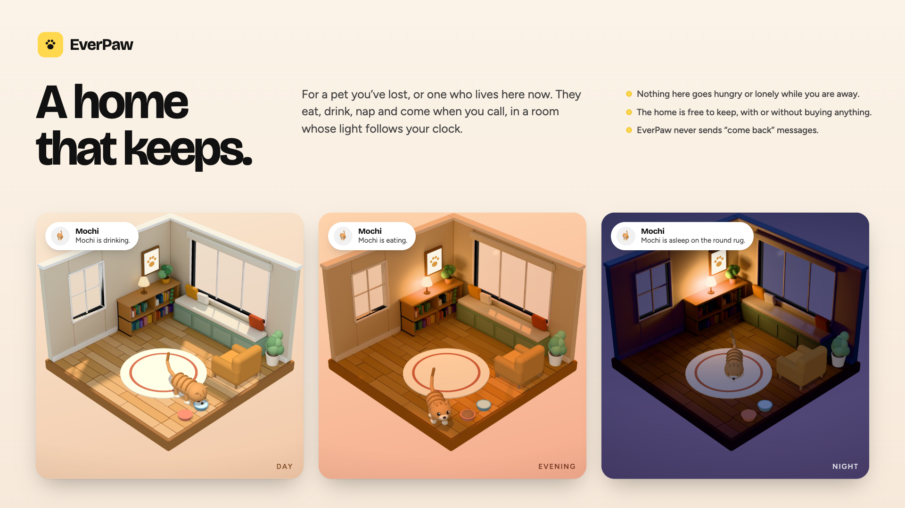
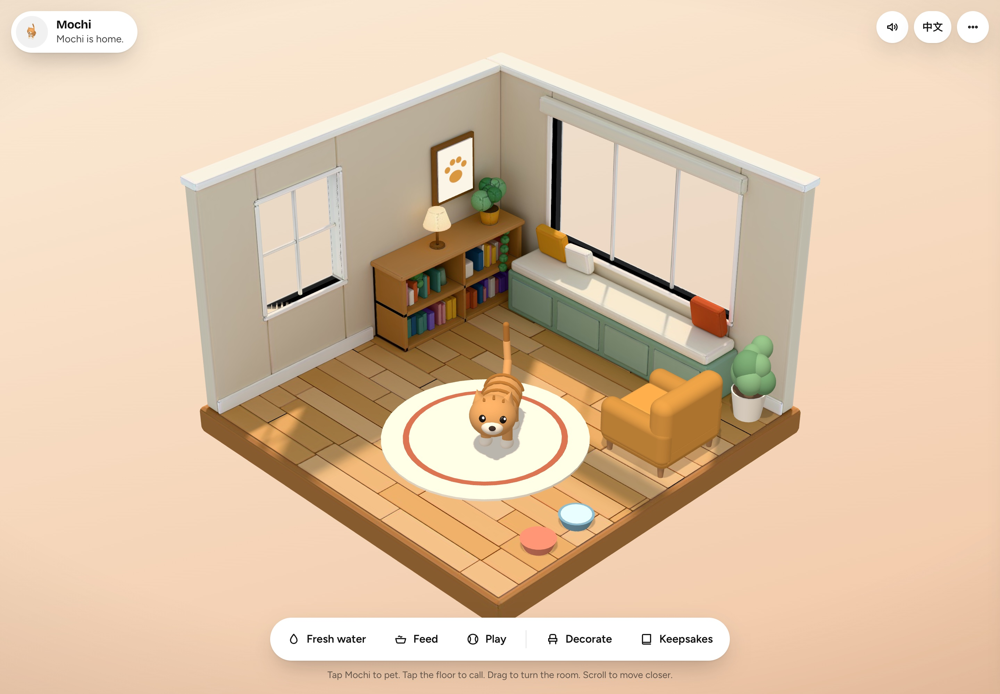
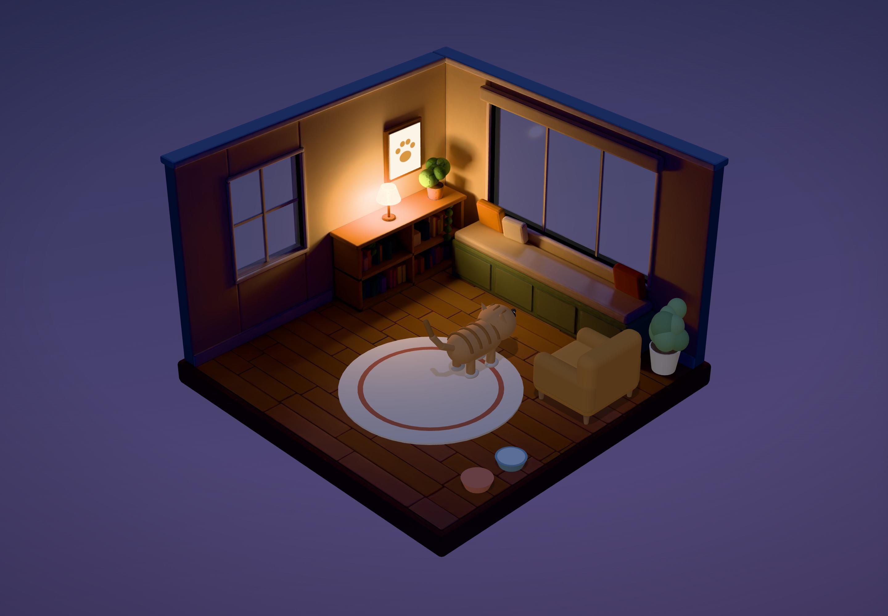
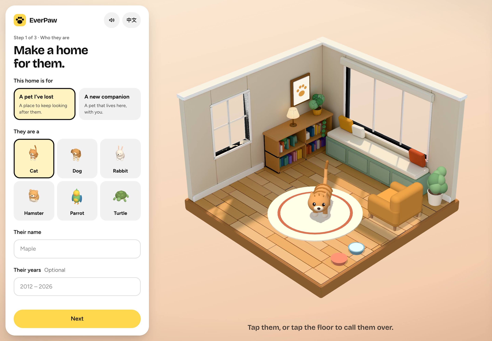
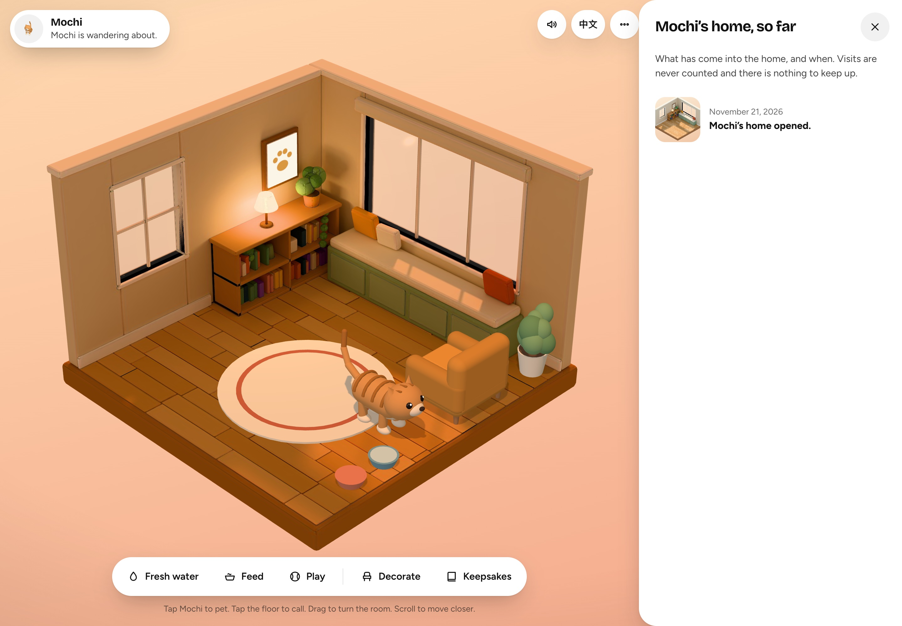

# EverPaw Home

[English](README.md) · 简体中文

**给已经离开的宠物，或者现在陪着你的小伙伴，一个小小的 3D 家。帮它换水、添饭，它会在屋里溜达、打盹，你一叫就过来。**

[打开 EverPaw →](https://cynthiawongss.com/everpaw/)



*同一个家的三个时刻，截自实际运行的网站，隐藏了按钮。Mochi 是虚构的猫；每张图上的文字，都是网站在那一刻显示的状态。*

宠物离开以后，家里会一下子空掉。EverPaw 给它们一个地方：一间安静的房间，它照样吃饭、喝水、玩耍、睡觉，你也可以在这里留几句想对它说的话。如果你从来没有养过宠物，也可以在这里养一只。

## 一个不向你索取什么的家

怀念不应该变成任务。下面这几条承诺，直接写在网站里。

| EverPaw 的承诺 | 具体是什么意思 |
| --- | --- |
| 你不在的时候，这里不会有谁挨饿或孤单。 | 没有饥饿值，它也不会难过。隔一天还是隔一年回来，它都只是在家里。 |
| 不统计来访次数，也没有需要坚持的任务。 | 没有连续打卡，没有目标，没有每日任务。 |
| EverPaw 不会发"快回来看看"这类消息。 | 提醒是关闭的，也没有可以打开的催促。 |
| 这个家可以一直免费保留，买不买东西都一样。 | 家具是可选的，没有任何功能需要付费解锁。 |
| 随时可以下载全部内容，或者删除。 | 整个家可以存成一个文件；删除后会从这台设备上移除。 |

## 能做什么

| 部分 | 内容 |
| --- | --- |
| 建一个家 | 三步。**它是谁**：一只已经离开的宠物，或者一只新的小伙伴；猫、狗、兔子、仓鼠、鹦鹉或乌龟；它的名字和年份。**它的样子**：三种毛色、五种花纹、三种体型。可以加一张照片：EverPaw 会从照片里读出它的毛色，并把照片挂在墙上。**住在哪里**：三间房间选一间。 |
| 陪着它 | **换水**、**喂饭**、**陪它玩**。点一下它可以摸摸它，点地板可以叫它过来，拖动可以转动房间，滚动可以拉近。屏幕上方有一行字告诉你它在做什么，比如"Mochi 在圆地毯上睡着了。" |
| 布置 | 从纸箱到猫爬架，共 14 样东西可以添置，摆在地板的格子上。有些会改变它的行为：放了小窝它就睡在那里，放了小球它会去追。 |
| 纪念 | 你写给它的话，以及这个家里什么东西在什么时候来到的简短记录。 |

## 光线跟着你的时间走

房间会跟着你设备上的时间变化：下午 5 点前是白天，到晚上 8 点是温暖的傍晚，之后是夜晚，台灯和蜡烛会亮起来。几秒钟不动，按钮就会慢慢淡出，屏幕上只剩下这个房间。

| 白天 | 夜晚，按钮已经淡出 |
| --- | --- |
|  |  |

## 一个例子：Mochi

这个虚构的家是在实际网站里做的：**一只已经离开的宠物** → **猫** → *Mochi*、*2011 – 2026* → **条纹** → **飘窗房** → **打开 Mochi 的家**。



在 **纪念** 里，这个家会记下它被打开的日期，以及之后添置的东西。来访不会被记录。



## 为 EverPaw 而做

三间房间（飘窗房、阁楼、玻璃花房）都是为这个项目在 Blender 里建的模型，白天、傍晚、夜晚的光线各自单独烘焙。宠物在 three.js 里搭建并做动画。界面支持英文和中文。

## 目前还不是真的

| 当前行为 | 对你意味着什么 |
| --- | --- |
| 只保存在这个浏览器里 | 没有账号，也没有云端同步。清理网站数据或换设备之前，请先用 **下载全部内容**。 |
| 照片决定毛色，不会生成模型 | 宠物是一只按你宠物毛色上色的风格化 3D 小动物，不是根据照片生成的模型。照片只保存在你的设备上。 |
| 测试结账 | 会显示 $0.99 到 $5.99 的价格，但支付还没有接通，不会扣款。 |
| 线上网站的访问统计 | 这个家本身不会记录你的来访，但线上网站加载了 Umami，会统计页面访问量。 |

## 本地运行

```bash
python3 -m http.server 8000
```

然后打开 http://localhost:8000/。不需要构建。

| 文件 | 作用 |
| --- | --- |
| `index.html`、`app.js`、`ui.css` | 界面和保存的状态 |
| `data.js` | 名称、价格，以及所有中英文文案 |
| `world.js` | 3D 房间、宠物和它们的行为、在格子上布置家具 |
| `sound.js` | 合成音效 |
| `rooms/` | 三间房间：模型，加上白天、傍晚、夜晚的烘焙光线 |
| `tools/build_rooms.py` | 建模并烘焙房间光线的 Blender 脚本 |
| `three/` | three.js r160（MIT，见 `three/LICENSE`） |

重新生成房间（需要 Blender 4.5 LTS）：

```bash
/Applications/Blender.app/Contents/MacOS/Blender --background --python tools/build_rooms.py -- rooms bay attic glass
```
